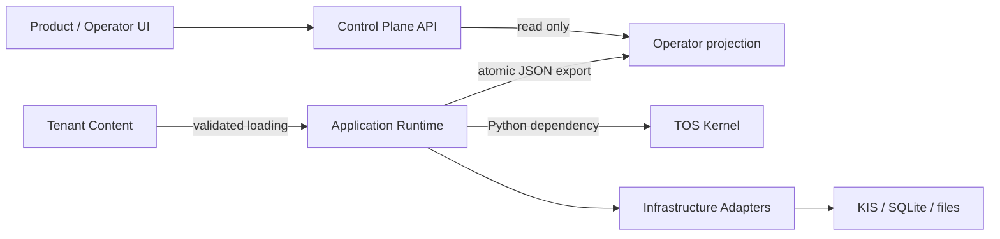

# TOS system context and layer ownership

기준: 2026-11-20. 이 문서는 현재 계층 명명의 정본이다. 명명과 책임을 정리하며 기존
규범·방화벽·실행 권한을 개정하지 않는다.

## 1. 공식 명칭과 책임

| 공식 명칭 | 소유 경로 | 책임과 경계 |
|---|---|---|
| TOS Kernel | `tos/src/tos/` | 결정·권한·위험·증거·전송 판정의 커널 타입, Protocol, 상태 전이. 제품 HTTP/UI를 소유하지 않는다. |
| Application Runtime + Infrastructure Adapters | `tos/runtime/src/tos_runtime/` | `compose`에서 커널과 구현체 결선; event driver, 복구·대사, 시간·시세·SQLite·custody·transport, 운영 CLI. 별도 배포 패키지 `tos-runtime`. |
| Control Plane API (BFF) | `services/dashboard/`의 TOS 표면 | 현재 projection 파일을 읽는 `GET /api/tos/projection`. 기존 dashboard 전체를 TOS 전용 API로 간주하지 않는다. |
| Product / Operator UI | `strategy-builder-ui/` | 운영자가 상태를 보는 제품 표면. 남은 것은 `/tos` 조회 화면 · `/` 리디렉트 · `/api` 프록시뿐이다(배포됨). |
| Tenant Content | `config/tos_runtime/<tree>/`(paper · cp3-setup-d-long/short · 주식 MOCK 셋), `tos/runtime/config/` | DSL 전략, construction/policy 설정, broker profile 참조. 실행 권한과 별개인 버전 관리 콘텐츠. |
| 잔존 공용 코드 | `shared/`, `services/dashboard/`, `cli/`, `tools/` | 레거시 거래 런타임은 2026-11 에 제거됐다(L1–L7). 남은 것은 TOS 뿌리가 import 하는 것(CP-3 생산자 · Setup D 증인 · KIS 인증 · 지표 · 설정 · 저장소 · 리스크 원시형)과 운영자 표면뿐이다. |

외부 KIS·파일시스템·SQLite는 런타임 어댑터가 접근하는 인프라다.
커널 아래에 구체 인프라를 import하는 계층을 두는 것으로 해석하지 않는다.

UI→API는 제품의 일반 경로이며 `/tos`가 projection API를 조회한다.
Control Plane→Runtime 명령 ingress는 현재 미구현이다 — TOS 표면은 읽기 전용이다.

## 2. 허용 의존 방향

- `tos_runtime → tos`: 허용. composition root는 `tos_runtime.compose` 한 곳.
- `tos → tos_runtime`: 금지. `tos/` 밖 코드가 둘 중 하나를 import하는 것도 금지.
- `tos_runtime → shared.*`: 전부 금지. 커널에만 여섯 pure-commons 예외가 있다.
- Dashboard→projection: 파일을 통한 읽기. dashboard에서 runtime 객체/DB를 직접 조작하지 않는다.
- 전략·상품 지식은 DSL/profile/config로 재저작한다. 레거시 executor/KIS/service 복사는 금지.
- repo 분리는 기존 live-gate 재검토 조건을 따른다. TOS를 새 repo로 이동하지 않는다.

정본: [boundary design §3·§6](../plans/2026-07-20-tos-boundary-and-import-firewall-design.md),
[실제 검사기](../../tools/tos_firewall_check.py), [import-linter](../../.importlinter).
이 문서와 규범이 충돌하면 기존 규범을 따르고 이 문서를 정정한다.

## 3. 현재 구현과 남은 경계

[composition root](../../tos/runtime/src/tos_runtime/compose/root.py)와
[CLI dispatcher](../../tos/runtime/src/tos_runtime/compose/cli.py)는 구현돼 있다.
synthetic과 KIS mock 전송 선택은 구현됐지만 실전 전송 승인과 동일하지 않다.
[운영 런북](../runbooks/tos-paper-boot.md)은 상주 paper·월물별 data dir·롤 동작을 기록한다.
해당 기록이 오늘의 실행 성공을 자동으로 증명하지는 않는다.

제품 연결은 schema v1 생산자·dashboard 소비자·`/tos` UI까지 구현됐다.
nullable 계약 fixture, UI freshness 설정과 read-only proxy를 추가했다.
공통 스키마 생성 산출물, 실제 배포 경로 검증, 알림 전달의
end-to-end 증거와 명령 ingress는 후속 범위다. 공개/내부 경계는
[인터페이스 카탈로그](tos-public-interfaces.md)를 따른다.

## 4. 함께 읽는 문서

- [Project status](../PROJECT_STATUS.md): 지금 무엇이 도는가.
- [플랫폼 로드맵](../plans/2026-11-11-tos-platform-roadmap.md) · [활용 계획](../plans/2026-11-19-tos-usage-plan.md): 어디로 가는가.
- [공개 인터페이스 카탈로그](tos-public-interfaces.md): 외부 계약과 런타임 내부 포트의 경계.

실전 선물 주문과 증거금 투입은 정책상 금지다. 이 문서의 cutover는 우선
paper scope에 한정하며 live 승격을 완료 조건으로 삼지 않는다.
